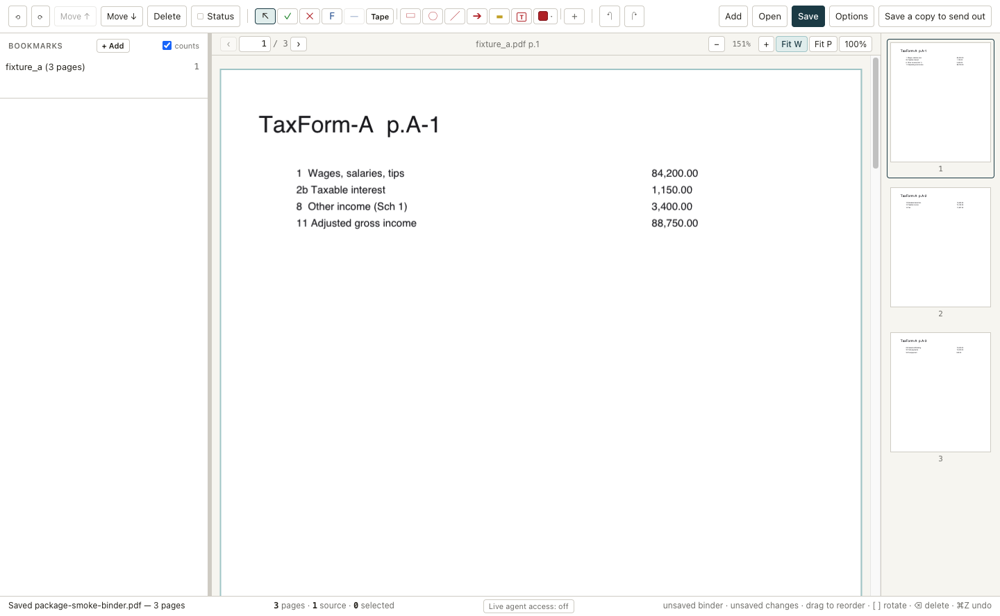

# LedgerPDF

[](https://github.com/charliebarmore/ledgerpdf/actions/workflows/linux.yml)
[](https://github.com/charliebarmore/ledgerpdf/releases/latest)
[](LICENSE)

**A local-first workpaper binder, built for tax and accounting professionals to
use alongside AI agents. A human and an agent can work in the same binder at the
same time.**

Drag in what you actually have. PDFs from your tax software, client documents,
Excel trial balances, scans, phone photos of receipts. LedgerPDF assembles
them into one ordered, bookmarked PDF binder. Place tick marks, drop calculator
tapes that show their addends, and link a figure to the page that supports it.



## What it does

- **One binder, one file.** The binder PDF *is* the document. Saving overwrites
  it, and an editable session rides inside the file itself — there is no sidecar
  project file to lose.
- **Marks that survive.** Tick marks, stamps, calculator tapes, shapes and notes
  export as standard PDF annotations, and render in Acrobat, Edge, Chrome and
  macOS Preview. Every mark's position is pixel-verified against two independent
  render engines.
- **Bookmarks that follow their pages.** Reorder anything; the outline moves with
  it. Drag a bookmark and its whole section of pages moves.
- **Real inputs.** PDFs, `.xlsx`/`.xlsm`/`.csv`, `.md`/`.docx`, and images. A
  spreadsheet becomes pages whose cells are real text, so a figure off a trial
  balance can be read exactly — not OCR'd, not guessed.
- **Whole-cent arithmetic.** Calculator tapes never touch floating point, and
  anything ambiguous is refused rather than assumed. A figure guessed wrong
  agrees confidently, which is worse than no figure at all.
- **Agents work in the same binder.** Not a chat box bolted onto a GUI — an MCP
  server exposing the same model the UI drives, so an agent reads pages, finds a
  figure by name, and marks the binder you have open. Everything it does is
  attributed to the AI and journalled. Agent-added marks, tapes, shapes and
  bookmarks are removable by run; structural page changes (imports, reorders,
  rotations, deletions) stay journalled but are not automatically undone — the
  history says exactly which is which.
- **A review pass before the file leaves.** The Review Center walks open notes
  and crosses, source coverage, page statuses, connector integrity, and every
  agent run. Creating a permanent send-out copy shows those same checks first;
  it does not quietly turn unfinished work into a delivery file.

## How it is built

An Electron + React front end over a **Python engine** (`pikepdf`/`qpdf`) that
does every PDF operation, spoken to as a JSON-over-stdio subprocess. The engine
is the same one the MCP server drives, so an agent and a person cannot produce
different artefacts. Annotation appearance streams are hand-authored, and page
geometry is resolved through one definition so a word's coordinates and a tick's
coordinates cannot mean different things.

| Path | What lives there |
| --- | --- |
| `app/src/main` | Electron main process: window, IPC handlers, the per-session file allowlist, the live agent host |
| `app/src/preload` | The only bridge the renderer is given |
| `app/src/renderer` | React UI. `session.ts` is the binder model; PDF.js renders pages and never writes |
| `app/src/mcp` | The MCP server an agent connects to |
| `app/src/shared` | Code the app and the MCP server share: folder containment, the binder lock, the engine subprocess |
| `engine/workpaper_engine` | The Python PDF engine: import, annotation appearance, outline, session storage, export |
| `app/scripts` | The verification suite |
| `spike/` | Synthetic fixtures and the cross-viewer conformance checks. Named for the feasibility spike it began as; CI depends on it |
| `tools/release` | Builds and validates the source tree published here |

The decisions that shape the code:

- **One PDF writer.** The renderer never touches a file; it asks the main
  process over IPC. Every PDF written to disk is written by the engine, which
  runs out of process with a scrubbed environment, a timeout and an output cap
  ([`app/src/shared/json-process.ts`](app/src/shared/json-process.ts)).
- **A locked-down renderer.** Context isolation on, Node integration off,
  sandbox on. The packaged UI loads from a custom `ledgerpdf://` scheme, not
  `file://`. Every IPC call checks its sender, and a file path is accepted only
  if the main process itself recorded it: from a dialog, a drag-and-drop, the
  operating system's open request, the recent-binder list, or an agent folder
  the user approved
  ([`app/src/main/index.ts`](app/src/main/index.ts)).
- **Agent access is local and opt-in.** A unix socket or named pipe, a fresh
  256-bit token each time agent access is switched on, compared in constant
  time
  ([`app/src/main/live-host.ts`](app/src/main/live-host.ts)), and folder
  containment resolved through real paths
  ([`app/src/shared/agent-roots.ts`](app/src/shared/agent-roots.ts)).
  [`DATA-FLOW.md`](DATA-FLOW.md) sets out every process and file boundary.

### How it is checked

- `npm run verify` type-checks the app, then drives the binder model, the
  engine, the MCP server and the real Electron app, GUI smoke test included.
- `npm run verify:viewers` renders a conformance binder in two unrelated
  engines, pdfium (what Chrome and Edge use) and poppler, and requires every
  mark to land within tolerance in both. If a mark lands in the same place in
  both, the geometry is a property of the PDF, not of one renderer.
  [`spike/README.md`](spike/README.md) records the original results, PDFKit
  (macOS Preview) included.
- CI runs the suite on Linux for every non-draft pull request and on `main`;
  macOS and Windows run on pull requests labelled `full-ci` and on manual runs.
  Actions are pinned by commit SHA and Python dependencies are hash-locked.

Known debt, stated rather than hidden: the checks are purpose-written scripts,
with no unit-test framework or linter configuration yet, and `App.tsx`,
`session.ts` and the MCP server are each a few thousand lines and due to be
split.

### How it is developed

LedgerPDF is designed, specified and reviewed by a practising CPA and written
with AI coding agents; the commit trailers say which. Day-to-day work happens in
a private engineering repository. This repository receives a reviewed source
export for each public update, which is why its history is a short series of
large commits. [`RELEASING.md`](RELEASING.md) describes the export and its
checks.

## Status

**Alpha.** Used daily by its author on real engagements. Expect rough edges, and
do not make it the only copy of anything.

- **Released:** [v0.3.1](https://github.com/charliebarmore/ledgerpdf/releases/tag/v0.3.1).
  The macOS build is Apple silicon only (the frozen Python engine is arm64),
  signed with a Ledger Labs LLC Developer ID certificate, notarized by Apple and
  stapled. The Windows installer is not
  code-signed yet. On Linux, run from source.
- **On `main`, not yet released:** engagement compilation. An external agent
  compiles a fresh binder from an engagement folder, using the prior-year master
  as its organizing reference, and leaves a handoff in the binder for human
  review. Filing choices keep their source quotes and reasons; inputs without
  verifiable support move to Needs filing. Quote provenance is checked;
  classification still needs human review. The workflow is under acceptance
  testing: see the [acceptance results](docs/ENGAGEMENT-ACCEPTANCE.md) for
  tested behavior and limits, and [DECISIONS.md](DECISIONS.md) for scope.
  Editable saves from this build use session format v7 and read v1-v6 binders;
  earlier builds refuse v7 files rather than drop what they cannot read.

### Getting a build

Download the installers and checksums from the
**[v0.3.1 release](https://github.com/charliebarmore/ledgerpdf/releases/tag/v0.3.1)**.

On **macOS**, open the `.dmg` or `.zip` and drag LedgerPDF to Applications. It
launches with no warning, offline included.

On **Windows**, run the installer. Because it is not signed yet, SmartScreen
**may** show an "unrecognised publisher" warning once. That prompt is about
*identity verification*, not about anything the software does.
[`docs/INSTALL-WINDOWS.md`](docs/INSTALL-WINDOWS.md) walks the install, says
plainly what the prompt means, and covers uninstalling.

In CI, packaging runs only on a manual workflow run, so pull requests do not
pay for it; those artifacts are unsigned, expire after 3 days, and are for
pilot testing, not redistribution. The signed macOS release is built and
notarized outside CI (see [`RELEASING.md`](RELEASING.md)). There is no Linux
installer; on Linux, build from source.

## Build from source

Requires Node 22.12+ and Python 3.12+. Expect roughly 1.3 GB on
disk once `node_modules`, the venv and a packaged build are all present.

**macOS / Linux**

```bash
git clone https://github.com/charliebarmore/ledgerpdf.git
cd ledgerpdf

python3 -m venv engine/.venv
engine/.venv/bin/pip install --require-hashes -r engine/requirements.lock
engine/.venv/bin/pip install --require-hashes -r engine/requirements-build.lock # packaging only

engine/.venv/bin/python spike/run_spike.py                      # build fixtures
```

**Windows (PowerShell)**

A virtual environment puts its interpreter in `Scripts\` on Windows rather than
`bin/`, and there is no `python3` on the PATH — `python3` there is a Microsoft
Store stub that will not create a venv.

```powershell
git clone https://github.com/charliebarmore/ledgerpdf.git
cd ledgerpdf

python -m venv engine\.venv
engine\.venv\Scripts\pip install --require-hashes -r engine\requirements.lock
engine\.venv\Scripts\pip install --require-hashes -r engine\requirements-build.lock # packaging only

engine\.venv\Scripts\python spike\run_spike.py                      # build fixtures
```

**Then, on either platform**

```bash
cd app
npm ci
npm run dev            # run it
npm run verify         # the full check suite
npm run package:dir    # a packaged app in app/release/
```

**Linux** was verified on a clean install on 2026-09-22 (Arch-based Omarchy,
Python 3.14.7, Node 26.7.0, empty home folder): the steps above, `npm ci` and
`npm run verify` all pass unchanged, including the checks that launch the app
window. A follow-up verified the unpacked packaged app as well. See
[`docs/LINUX-VERIFICATION.md`](docs/LINUX-VERIFICATION.md) for the scope and limits.

Two notes on the steps above, both of which otherwise fail on a clean clone:

- **Fixtures are gitignored** — they are synthetic and never committed — so
  `spike/run_spike.py` has to run once before `npm run verify` has anything to
  check. CI regenerates them the same way.
- **`requirements-build.lock` is separate** and holds PyInstaller, which freezes
  the Python engine into the packaged app. Skip it and `npm run dev` still
  works; `npm run package:dir` fails with `No module named PyInstaller`.

`npm run dev` takes roughly fifteen seconds to show a window the first time —
Vite builds the main and renderer bundles before Electron launches. It is not
hung.

## Where your data goes

**The application makes no network calls.** No telemetry, no accounts, no cloud,
no auto-update phoning home. Your binders and the documents behind them stay on
your machine, in the engagement folder you chose. Live agent access is a **local**
unix socket or named pipe, never a TCP port, off by default, and requires a fresh
256-bit token each launch. POSIX also applies owner-only socket permissions;
Windows keeps the token file beneath the user's profile ACL.

**The one thing that can leave the machine is an AI agent you connect**, and the
distinction matters professionally: even then LedgerPDF is not what reaches the
network. Your MCP client is a separate program under your control, and the page
content it reads goes wherever that program sends it. With a hosted model that is
a disclosure of client information; with a locally-run model nothing leaves at
all. Either way it is your decision, and LedgerPDF does not make it for you.
Standalone agent filesystem access is disabled unless you explicitly approve
engagement folders in the app under Agent access. That approval permits reading
documents and creating or updating LedgerPDF files inside those folders, and it
persists when live access to the open binder is off. Operations outside the
approved folders are refused.

### What it does not do

Stated as plainly as the list above, because the absences matter more than the
features when you are deciding whether to put client data in something:

- Encrypt your files, enforce a retention schedule, or guarantee secure erasure.
- Provide central access control, reviewer sign-off, an immutable audit log, or
  any central administration. It does prevent two local LedgerPDF/agent
  processes from writing the same binder at once; that is a file-integrity lock,
  not a firm-wide permissions system.
- Decide what an agent may read or write. Standalone file access stays off until
  you approve folders yourself, and operations outside them are refused.
- Control what your AI client does with what it reads. That program is separate
  and under your control rather than ours.
- Make any determination about §7216, your WISP, Circular 230, or anything else
  you answer to. It cannot, and does not try.

### Considerations, not assurances

Nothing below is a compliance claim or a legal opinion. These are questions a tax
or accounting professional will want to work through, each set beside the plain
facts about how the application behaves. The questions are yours to settle. The
facts are ours to state and be held to.

- **IRC §7216 / §6713.** *To consider:* whether anything you do here involves a
  disclosure or use of return information, and if so what consent that calls for
  and in what form (Treas. Reg. §301.7216-3). *The facts:* the application makes
  no network calls; agent file access is off until you name folders in
  Agent access; once you do, a standalone agent can read documents and create or
  update LedgerPDF files there. Page text can include the SSN on a 1040.
- **FTC Safeguards Rule (16 CFR Part 314) and the WISP it requires.**
  *To consider:* how a local tool fits the written information security program
  you maintain, and which controls it supplies against which it leaves to you.
  *The facts:* binders, working copies and recovery files sit in the engagement
  folder you chose rather than a temp directory or a vendor's storage, owner-only
  on POSIX and inheriting folder permissions on Windows. The app does not encrypt
  files itself, enforce retention, or provide access control or administration.
  IRS Pubs 4557 and 5708 are useful starting points.
- **Circular 230 (31 CFR Part 10).** *To consider:* how you supervise
  machine-produced work, and how a reviewer tells it from your own. *The facts:*
  agent actions are attributed to the AI and journalled in order; the marks a
  run added can be removed in one step, and the history names the structural
  changes that cannot be; agent marks are outlined on the page. The tool reaches
  no conclusions and signs nothing.
- **AICPA Code of Professional Conduct.** *To consider:* whether connecting an
  agent brings a model provider into the engagement as a third party for
  confidentiality purposes, and what consent or agreement you would want first.
  *The facts:* with no agent connected there is no vendor account, telemetry
  endpoint or support tunnel in the software. Connect one and what it reads goes
  wherever that program sends it.

This list is not complete and is not meant to be. State board rules and
breach-notification statutes vary, and your firm's analysis governs. The source
is published under GPL-3.0 so you or your IT reviewer can verify the factual half
against the code rather than take it on trust;
[`DATA-FLOW.md`](DATA-FLOW.md) sets out where every file goes.

## Disclosures and support

LedgerPDF is software, not accounting, tax, legal, investment, audit, assurance,
or other professional advice. You remain responsible for reviewing its output,
supervising agent work, protecting client information, and maintaining
independent backups. Before using it with client data, read:

- [`DISCLAIMER.md`](DISCLAIMER.md) — professional, review, AI, warranty, and
  liability limitations;
- [`PRIVACY.md`](PRIVACY.md) — local files, recents, optional agent access, the
  website, and third-party services;
- [`TERMS.md`](TERMS.md) — website and official-build distribution terms that do
  not reduce the rights granted by GPL-3.0; and
- [`SUPPORT.md`](SUPPORT.md) — how to report an issue without disclosing client
  information. Suspected vulnerabilities belong in the private channel in
  [`SECURITY.md`](SECURITY.md), not a public issue.

## Licence

Copyright © 2026 **Ledger Labs LLC**. Released under the **GNU General Public
Licence v3.0 or later** — see [`LICENSE`](LICENSE), with the reasoning and a
dependency-compatibility audit in [`COPYRIGHT.md`](COPYRIGHT.md).

Copyleft is deliberate. The claim above — that the application makes no network
calls — is only worth what your own IT reviewer can check, and this way they
can check it. (A connected agent is a separate program under your control, and
what IT carries off the machine is governed by the client you chose — see the
data-flow notes above.)

## Contributing

Feedback and bug reports are the most useful thing you can send. See
[`CONTRIBUTING.md`](CONTRIBUTING.md) — and please read the note there about not
attaching real client documents.

---

Built by [Charlie Barmore](https://cbarmorecpa.com), CPA/CFE, because assembling
a binder is hours of work a competent agent could do, and no workpaper tool was
built for one to drive.
